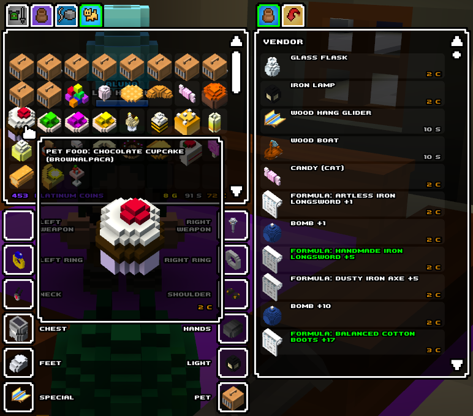

# Cube World Pet Food Names Mod

Adds the name of the pet that a pet food tames to its name in parentheses, so
you always what it tames. The name is shown wherever the game shows the item
name: tooltips, vendor lists, pickup widgets and pickup messages.

*The item is named with the pet name in parentheses wherever it is used.*

This mod is for the **alpha** build of Cube World.

## Installation

* requires [coremaze Cube-World-Mod-Launcher](https://github.com/coremaze/Cube-World-Mod-Launcher/releases/tag/v1.5)
* unpack Mod Launcher in the game directory
* put `PetFoodNamesMod.dll` into `Mods`
* start the game via `CubeModLauncher.exe`

## Compilation

Requires a compiler that targets 32-bit Windows. Due to the `asm` style, `MSVC`
will not work, use `GCC` or `Clang`. Run `make` in this directory and specify
the compiler as `CXX` variable if necessary (e.g.
`make CXX=i686-w64-mingw32-g++`).
